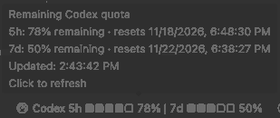

# Codex Usage Monitor VS Code

Independent, local-only status bar monitor for OpenAI Codex, by danilfg. Not affiliated with OpenAI.

Requires the official OpenAI Codex VS Code extension (`openai.chatgpt`) and an existing ChatGPT sign-in. No separate login is needed if the local app server can reuse that sign-in.

## Screenshots

### Status bar

### Hover details

*Screenshot from v0.1.0; v0.1.1 also displays the time zone and countdown.*

Click the indicator to open the styled details card in a VS Code editor Webview. It shows continuous colored progress bars, reset dates, local time zones and countdowns. The color is green above 50%, amber from 21–50%, red at 20% and below. Click outside the card, switch editor focus, press Escape or click × to close it. VS Code does not support anchoring arbitrary Webviews directly above the status bar. The screenshot above shows the older hover interface.

## Install locally

Clone this repository, open it in VS Code, and press F5 to launch the Extension Development Host (the official Codex extension must be installed there too). To package: `npx --yes @vscode/vsce package --no-dependencies`, then `code --install-extension codex-usage-monitor-vscode-0.1.3.vsix`. Packaging downloads a build tool; the extension itself has no runtime dependencies.

## Usage

The status bar displays remaining percentages. Click to open details with full reset dates, local time zone and countdown. Use the refresh button in the details card to refresh. Polling defaults to 60 seconds. Missing or stale data is shown explicitly, not as 100%. Settings: `codexUsageMonitor.refreshSeconds` and `codexUsageMonitor.showBars`.

## Security

The extension launches only the bundled native executable from the installed `openai.chatgpt` extension, using stdio without a shell. The only protocol messages sent are `initialize`, `initialized`, and `account/rateLimits/read`. No direct HTTP requests, credential file reads, telemetry, model prompts, or credit reset requests. The official Codex executable itself connects to OpenAI and manages authentication. VS Code extensions are not OS-sandboxed: inspect source and updates before installing.

Protocol: https://learn.chatgpt.com/docs/app-server

## Tests

Run `npm test` with Node.js 20 or newer.
